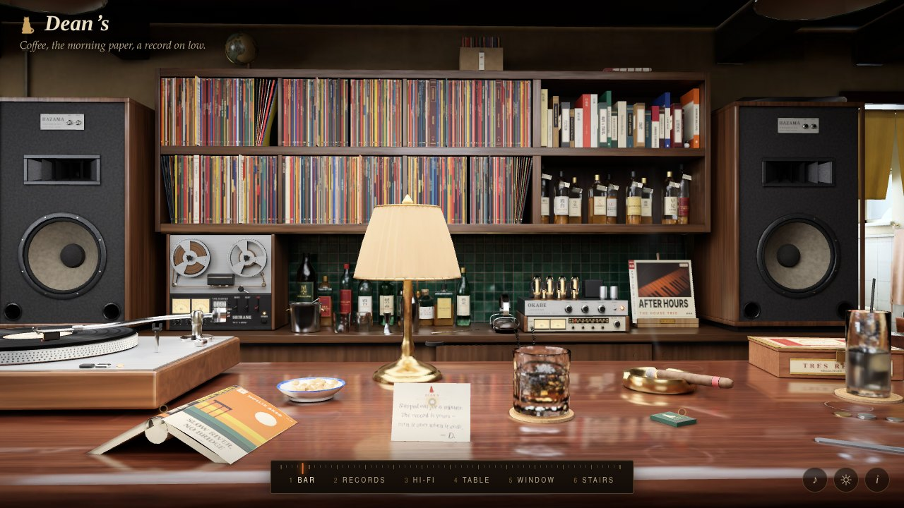

# Dean's

A personal website that is one room: a small basement jazz bar in late-1970s Tokyo, a few minutes
after closing. Coffee shop by day, records and whisky by night (it follows the visitor's clock).
Records are posts, the manuscript is writing in progress, the regulars' bottles are projects, and
the half-open door leads downstairs.

| Night, from the bar stool | Day |
|---|---|
|  |  |
|  |  |

**Status:** a working first version. All text in the site is placeholder sample content, and the
page is marked `noindex` until that is replaced (see "Before you go live").

## What is in this repo

```
site/              the website. Plain static files, no build step. This folder is what gets deployed.
  index.html, style.css, main.js, panels.js, fx.js, audio.js, occlude.js
  content.js       every word shown in the panels (edit this)
  bar.glb          the room (about 144k triangles)
  scene.json       camera stops, lamp positions and other data exported with the model
  tex/             baked lighting: one night and one day texture per part
  vendor/three/    three.js r187 (MIT), vendored so nothing loads from a CDN
  _headers         cache rules read by Cloudflare
  404.html
wrangler.jsonc     Cloudflare config: "serve ./site"
blender/           the source of the 3D room: Python scripts that build it in Blender
  SPEC.md          the creative brief and the rules every part follows
  barkit/          shared layout, modelling kit and the build / bake / export pipeline
  parts/<part>/    one script per part: shell, counter, shelves, hifi, nook, lounge, cat
tools/             bundle.py (single-file HTML build), shot.py (headless screenshots)
docs/              screenshots used in this README
```

## Run it locally

```bash
python3 -m http.server 8080 --directory site
# open http://localhost:8080
```

It must be served over http (not opened as a file), because the page loads modules and textures.

Useful while testing: `#night` or `#day` in the URL forces the lighting, `#cat=sleep|sit|watch`
picks where the cat is, and `#post-first-pressing` style links open a panel directly.

## Deploy on Cloudflare with your own domain

The repo is set up for **Cloudflare Workers with static assets** (`wrangler.jsonc` points at
`./site`). There is no build step and no server code.

### Option A: connect the GitHub repo in the dashboard (deploys on every push)

1. In the Cloudflare dashboard open **Workers & Pages**, choose **Create**, and import this
   repository from GitHub.
2. Leave the build command empty. The deploy command is `npx wrangler deploy` (the default).
   Cloudflare reads `wrangler.jsonc` and uploads `site/`.
3. After the first deploy, open the Worker's **Settings**, find **Domains & Routes**, and add a
   **Custom domain** (for example `deans.example.com` or the apex). The domain has to be on the
   same Cloudflare account; Cloudflare creates the DNS record and the certificate.

Menu names in the dashboard change from time to time; the three steps are always: import the repo,
deploy, attach a custom domain.

### Option B: deploy from your machine

```bash
npx wrangler login
npx wrangler deploy
```

Then attach the custom domain as in step 3, or add it to `wrangler.jsonc`:

```jsonc
"routes": [{ "pattern": "deans.example.com", "custom_domain": true }]
```

### If you prefer Cloudflare Pages

It also works as a Pages project: framework preset **None**, build command empty, build output
directory `site`. Cloudflare now recommends Workers for new projects, which is why this repo
defaults to it.

## Before you go live

- **Replace the sample content** in `site/content.js`. The six post titles are printed on the 3D
  record covers (`First Pressing`, `Side B Is Where the Truth Is`, `A Map of Small Hours`,
  `Standards, Slightly Wrong`, `The Quiet Refactor`, `Rain on B1`); keep those titles or re-paint
  the covers (see below).
- **Remove the `noindex` line** in `site/index.html` once the content is yours.
- **Check it on your own devices.** It has only been tested in a headless browser with software
  rendering: frame rate on a real GPU, the sound (off by default) and touch input are unverified.
- **Known weak spots:** portrait phones show the room in a narrow band; the first load is about
  10 MB (model 3.8 MB, night or day textures about 4 MB, three.js 1.3 MB); baked lighting is soft
  up close because it was baked at low sample counts on a CPU.

## Rebuilding the 3D room

Everything in `site/bar.glb`, `site/scene.json` and `site/tex/` is generated from `blender/`.
Nothing is modelled by hand and no downloaded assets are used.

Requirements: Python 3.13, then `pip install bpy numpy pillow scipy scikit-image` (`bpy` 5.x is
Blender as a Python module; no Blender install needed). The texture scripts load fonts from Linux
system paths (DejaVu, Noto CJK, IPAGothic under `/usr/share/fonts`); on macOS or Windows, edit the
font paths at the top of each `blender/parts/*/tex.py` or run this step in a Linux container.

```bash
blender/make_textures.sh        # paint labels, posters, covers (once, and after editing any tex.py)
blender/bake_all.sh --test      # quick low-resolution run, about 2 minutes: checks everything works
blender/bake_all.sh             # full bake: 9 atlases x (night + day), about 25 min on 2 CPU cores
```

`bake_all.sh` overwrites `site/bar.glb`, `site/scene.json` and `site/tex/*.jpg`. The full bake
writes high-quality JPEGs (about 13 MB in total); the ones committed here were recompressed to
about 8 MB.

Working on one part:

```bash
python3 blender/barkit/run.py preview counter --cam bar --mode night     # render it inside a grey mock-up of the room
python3 blender/barkit/run.py baketest counter                           # push it through the real pipeline at low res
```

Where things live:

- `blender/barkit/layout.py` is the single source of truth for every measurement, camera stop and
  light. Change the lighting or a camera there, then re-bake.
- For better quality, raise the sample count and resolution in `barkit/pipeline.py` (`bake()`:
  `lo, hi, spp`) and bake on a machine with more cores. Cycles runs on CPU here; switching
  `cycles_setup()` to a GPU device makes high sample counts practical.
- Adding a post means adding a sleeve in `blender/parts/shelves/` (cover art in its `tex.py`),
  re-baking the `shelves` and `shelves_b` atlases, and adding the text in `site/content.js`.

## Single-file build

`python3 tools/bundle.py site dist deans-bar.html` writes one self-contained HTML file (about
17 MB) with the model and textures embedded, handy for sending the site to someone.

## Credits

- [three.js](https://threejs.org) (MIT licence, see `site/vendor/three/LICENSE`).
- Fonts are loaded from Google Fonts with system fallbacks.
- Room, models, textures and page were generated with Claude; all labels, titles, makers' names and
  texts in the scene are invented.
