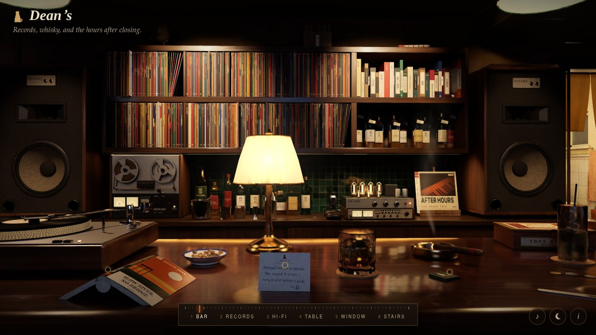
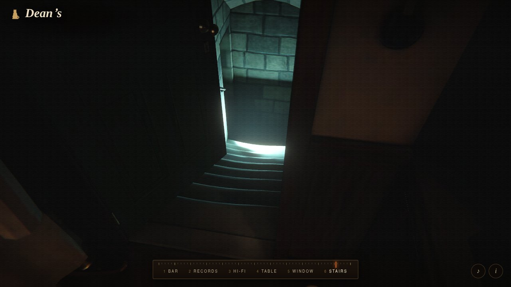
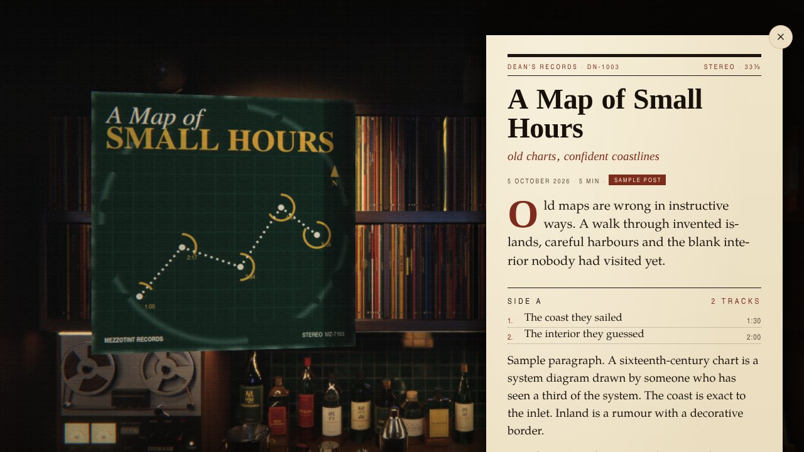
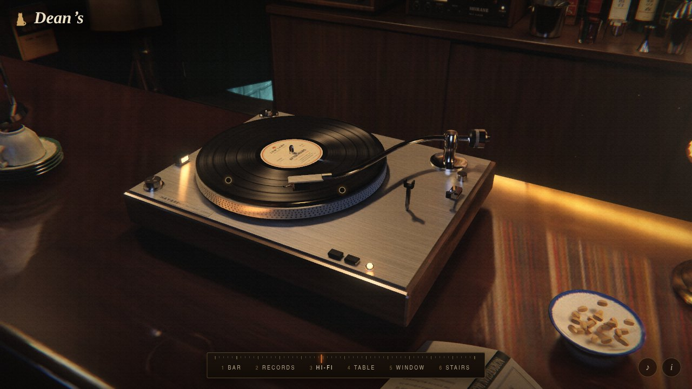
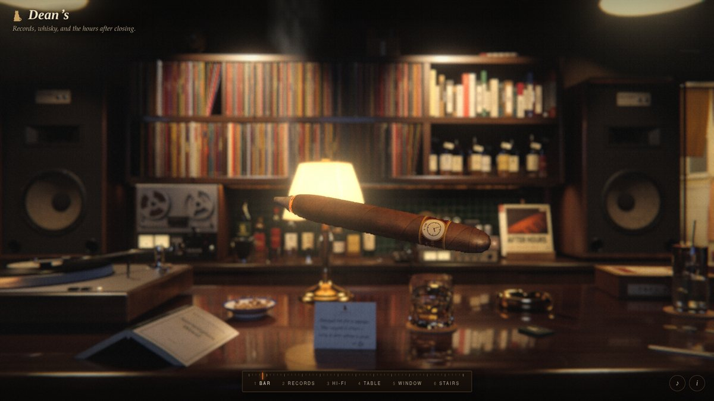
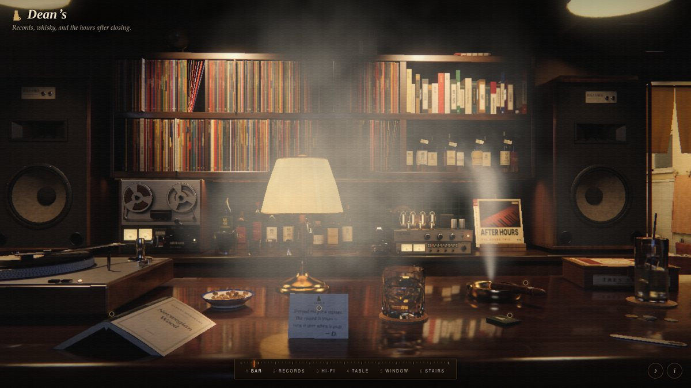

# Dean's

A personal website that is one room: a small basement jazz bar in late-1970s Tokyo, a few minutes
after closing. It is always night down here. Records are posts, the manuscript is writing in
progress, the regulars' bottles are projects, and the half-open door leads downstairs.

| From the bar stool | The stairs |
|---|---|
|  |  |
|  |  |

**Status:** a working first version. All text in the site is placeholder sample content, and the
page is marked `noindex` until that is replaced (see "Before you go live").

## What is in this repo

```
site/              the website. Plain static files, no build step. This folder is what gets deployed.
  index.html, style.css, main.js, panels.js, fx.js, audio.js, occlude.js
  post.js          the lens: autofocus + depth of field, bloom, film grain, vignette (see below)
  content.js       every word shown in the panels (edit this)
  bar.glb          the room (about 144k triangles)
  scene.json       camera stops, lamp positions and other data exported with the model
  tex/             baked lighting: one texture per part (2048 px, path-traced and denoised)
  vendor/three/    three.js r187 (MIT), vendored so nothing loads from a CDN
  _headers         cache rules read by Cloudflare
  404.html
wrangler.jsonc     Cloudflare config: "serve ./site"
blender/           the source of the 3D room: Python scripts that build it in Blender
  SPEC.md          the creative brief and the rules every part follows
  barkit/          shared layout, modelling kit and the build / bake / export pipeline
  parts/<part>/    one script per part: shell, counter, shelves, hifi, nook, lounge, cat
tools/             bundle.py (single-file HTML build), shot.py (headless screenshots),
                   glbdiff.py / glbkeep.py (compare two exports; keep an untouched mesh's old UVs)
docs/              screenshots used in this README
```

## Run it locally

```bash
python3 -m http.server 8080 --directory site
# open http://localhost:8080
```

It must be served over http (not opened as a file), because the page loads modules and textures.

Useful while testing: `#nolens` shows the bare bake without the lens, `#cat=sleep|sit|watch`
picks where the cat is, and `#post-first-pressing` style links open a panel directly. In the console,
`__poc.smoke()` takes a puff and `__poc.smoke(1.6, true)` freezes one 1.6 s in.

### The cigar

The cigar in the ashtray is the one thing in the room you can use rather than read. Click it (from
the bar stool): it is lifted and held up for a moment, goes to the mouth, the lit end glows as you
draw, and the smoke is let out into the room while it goes back to its notch. The ash gets longer
with each draw and is knocked off on about the third. With the sound on you hear the draw and the
breath out. With "reduce motion" set in the system it stays in the ashtray and simply glows and smokes.

| Held up | Let out |
|---|---|
|  |  |

It is a 6 × 47 perfecto (152 mm, nipple foot, full belly, rounded head) in the manner of a Hemingway
Signature, with a reddish Cameroon-style wrapper; the shape lives in `cigar_r()` in
`blender/parts/counter/build.py`, the leaf and the band are painted in `blender/parts/counter/tex.py`
(`cigar_leaf`, `cigar_ring`). The band is the house marque that is also on the cigar box, not a real
maker's. In the model it is two meshes, `cigar` and `cigar_ash`, which share a small atlas of their
own with the ashtray (`counter_b`, 1024 px), so a change to the cigar is a four-minute bake
(`run.py bake counter_b`, `run.py post counter_b`) and not the whole counter. Where it lies comes from
`layout.CIGAR`, and `scene.json` carries three points on its centre line (`cigar_foot`, `cigar_ember`,
`cigar_head`) that the page poses it from. The timings are `CG_T` in `site/main.js`; the smoke is
`makePuff()` in `site/fx.js`.

### The lens

The room is unlit in the browser (all light is baked), so what makes it read as a photograph is
`site/post.js`. The room is drawn into a multisampled float buffer, then: an autofocus that
meters a point per camera stop and racks focus to whatever you pick up; depth of field from real
distances at half resolution; bloom from a mip chain with a warm halation tint; a little lateral
chromatic aberration, an optical vignette, a gentle film shoulder and split tone; and animated grain
with dither. All of its numbers live in `Lens.params`. Browsers without float render targets get the
plain bake.

### Performance

The room itself is cheap (about 50 draw calls, 127k triangles, unlit: around 1 ms on a laptop GPU).
What a frame costs is the lens, and the lens costs in proportion to the pixels on screen. Measured on
an M1 Pro (14-inch, 120 Hz) with the window at 1512 x 860, which is 3024 x 1720 real pixels:

| | GPU time per frame | Frames per second |
|---|---|---|
| Bare room (`#nolens`) | about 1 ms | 120 |
| The lens before 17 Nov 2026 | 10.5 ms | 50, uneven |
| The lens now | 4.5 ms | 100 |

Three things made the difference, and they are the things to keep an eye on when changing `post.js`:

- **Depth of field read too much.** Every one of its 40 taps fetched the full-resolution depth, the
  focus distance and the full-resolution colour. Now one pass writes the picture at half resolution
  with each pixel's circle of confusion in the alpha channel, and the blur reads only that: 32 taps,
  one fetch each.
- **The multisampled room buffer was too big.** Four samples of RGBA16F at 3024 x 1720 is 166 MB to
  store and resolve on every frame. It is now packed 11/11/10-bit floats (half the bytes, still room
  above 1.0 for the bloom, finer steps than the 8-bit textures the room is made of), with two samples
  per pixel where the screen is dense (pixel ratio 1.5 and up) and four where it is not.
- **Bloom's largest level was half resolution.** The chain now starts at quarter resolution; the
  sharpest level is not a buffer at all, the last pass works it out from the half-resolution picture.

**Adaptive quality** (`adapt()` in `site/main.js`) aims at 60 frames a second. Frame times are
averaged over 1.5 s; two slow averages in a row (below about 54 fps) take one step down: first the
lens gives up multisampling and half its blur taps, then the resolution comes down in three steps of
0.8, then depth of field goes. It never steps back up within a visit. If the bottom is reached and
frames are no shorter than at the start, the GPU was never the limit (a 30 Hz display, a browser
saving energy), and everything is put back. The resolution is also capped at the pixel count of a
4K screen, so a 5K display does not do twice the work of a laptop for nothing.

To measure: `__poc.info()` gives the current `level`, `ratio` and the lens's buffer size and sample
count; `__poc.level(n)` pins a level (0 everything, 5 least), `__poc.res(r)` pins a pixel ratio, and
`#fixedres` switches the adapting off. Timer queries are useless on Apple GPUs (every pass reports the
whole frame); what works is rendering N frames in a loop and reading one pixel back at the end
(`gl.readPixels`), which waits for the GPU, and comparing with one pass left out. Software GL
(`tools/shot.py`) says nothing about speed.

## Deploy on Cloudflare with your own domain

The repo is set up for **Cloudflare Workers with static assets** (`wrangler.jsonc` points at
`./site`). There is no build step and no server code.

### Option A: connect the GitHub repo in the dashboard (deploys on every push)

1. In the Cloudflare dashboard open **Workers & Pages**, choose **Create**, and import this
   repository from GitHub.
2. Leave the build command empty. The deploy command is `npx wrangler deploy` (the default).
   Cloudflare reads `wrangler.jsonc` and uploads `site/`.
3. After the first deploy, open the Worker's **Settings**, find **Domains & Routes**, and add a
   **Custom domain** (for example `deans.example.com` or the apex). The domain has to be on the
   same Cloudflare account; Cloudflare creates the DNS record and the certificate.

Menu names in the dashboard change from time to time; the three steps are always: import the repo,
deploy, attach a custom domain.

### Option B: deploy from your machine

```bash
npx wrangler login
npx wrangler deploy
```

Then attach the custom domain as in step 3, or add it to `wrangler.jsonc`:

```jsonc
"routes": [{ "pattern": "deans.example.com", "custom_domain": true }]
```

### If you prefer Cloudflare Pages

It also works as a Pages project: framework preset **None**, build command empty, build output
directory `site`. Cloudflare now recommends Workers for new projects, which is why this repo
defaults to it.

## Before you go live

- **Replace the sample content** in `site/content.js`. The six post titles are printed on the 3D
  record covers (`First Pressing`, `Side B Is Where the Truth Is`, `A Map of Small Hours`,
  `Standards, Slightly Wrong`, `The Quiet Refactor`, `Rain on B1`); keep those titles or re-paint
  the covers (see below).
- **Remove the `noindex` line** in `site/index.html` once the content is yours.
- **Check it on your own devices.** It has only been tested in a headless browser with software
  rendering: frame rate on a real GPU, the sound (off by default) and touch input are unverified.
- **Known weak spots:** portrait phones show the room in a narrow band; the first load is about
  10 MB (model 3.8 MB, textures about 5 MB, three.js 1.3 MB).

## Rebuilding the 3D room

Everything in `site/bar.glb`, `site/scene.json` and `site/tex/` is generated from `blender/`.
Nothing is modelled by hand and no downloaded assets are used.

Requirements: Python 3.13, then `pip install bpy numpy pillow scipy scikit-image` (`bpy` 5.x is
Blender as a Python module; no Blender install needed). The texture scripts load fonts from Linux
system paths (DejaVu, Noto CJK, IPAGothic under `/usr/share/fonts`); on macOS or Windows, edit the
font paths at the top of each `blender/parts/*/tex.py` or run this step in a Linux container.

```bash
blender/make_textures.sh        # paint labels, posters, covers (once, and after editing any tex.py)
blender/bake_all.sh --test      # quick low-resolution run, about 2 minutes: checks everything works
blender/bake_all.sh             # full bake: 10 atlases (2048 px; the small counter_b at 1024), 64 samples + denoise (slow on 2 CPU cores; see below)
```

`bake_all.sh` overwrites `site/bar.glb`, `site/scene.json` and `site/tex/*.jpg`. Every atlas is
path-traced at full resolution (light, albedo and normals at 2048 px) and then cleaned with
OpenImageDenoise (run through Blender's compositor, guided by the albedo and normals).
`BAR_SPP=128 blender/bake_all.sh` or `BAR_RES=4096` trade time for an even cleaner result. The
textures committed here were baked at 32 to 64 samples on two CPU cores (about an hour and a half)
and saved as JPEG quality 84.

Working on one part:

```bash
python3 blender/barkit/run.py preview counter --cam bar --mode night     # render it inside a grey mock-up of the room
python3 blender/barkit/run.py baketest counter                           # push it through the real pipeline at low res
```

Where things live:

- `blender/barkit/layout.py` is the single source of truth for every measurement, camera stop and
  light. Change the lighting or a camera there, then re-bake.
- For better quality, raise `BAR_SPP` / `BAR_RES` (read in `barkit/pipeline.py`) and bake on a
  machine with more cores. Cycles runs on CPU here; switching `cycles_setup()` to a GPU device makes
  high sample counts practical.
- The `shelves` atlas does not pack the same way twice. After an `assemble` + `export` for some other
  part, `tools/glbdiff.py old.glb new.glb` shows which meshes moved in UV space; for the ones you did
  not touch, either bake their atlas again or keep their old UVs with
  `tools/glbkeep.py old.glb site/bar.glb shelves_static` (it copies them across only if the geometry
  is identical), so the texture already in `site/tex/` stays valid.
- Adding a post means adding a sleeve in `blender/parts/shelves/` (cover art in its `tex.py`),
  re-baking the `shelves` and `shelves_b` atlases, and adding the text in `site/content.js`.

## Single-file build

`python3 tools/bundle.py site dist deans-bar.html` writes one self-contained HTML file (about
17 MB) with the model and textures embedded, handy for sending the site to someone.

## Credits

- [three.js](https://threejs.org) (MIT licence, see `site/vendor/three/LICENSE`).
- Fonts are loaded from Google Fonts with system fallbacks.
- Room, models, textures and page were generated with Claude; all labels, titles, makers' names and
  texts in the scene are invented.
